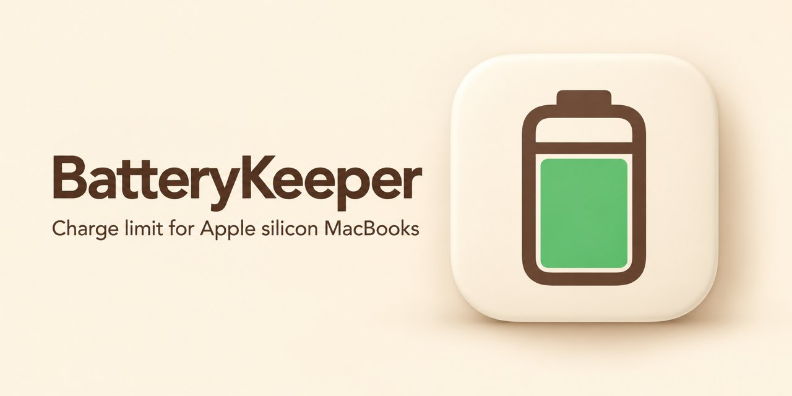

# BatteryKeeper

[](https://github.com/nervouna/batterykeeper/releases/latest)

[](LICENSE)



A macOS menu bar app for Apple silicon MacBooks. It sets the system's own charge limit, runs a scheduled calibration cycle, records battery statistics and draws a configurable menu bar icon.

<!-- screenshots -->

## Status

BatteryKeeper is a personal project, built to replace the parts of AlDente Pro its author used, and tested on the author's M1 Pro MacBook. It is at version 0.1. Running it takes an Apple silicon MacBook with macOS 27 or later. Calibration cycles also need the privileged helper, which only runs from a build signed with an Apple developer team identity; the charge limit, statistics and menu bar icon work without it. The interface is in Simplified Chinese and English. There are no releases yet: build it from source. A source-only v0.1.0 release will follow.

## How it is built

Most of the code is written by Claude Code agents. `CLAUDE.md` holds the rules they follow: the architecture, the charge control facts for macOS 27, the helper's fail-safe rules, and the rules for implementers (logic in `BatteryKeeperCore` with unit tests, no third-party dependencies, hardware paths checked on a real Mac). See [CONTRIBUTING.md](CONTRIBUTING.md) to report a bug or send a fix, and [SECURITY.md](SECURITY.md) for security problems.

## What it does

- **Charge limit**: sets the system's own Charge Limit (80, 85, 90, 95 % or Off) and offers "Charge to Full Now". macOS enforces the limit, also when BatteryKeeper is not running.
- **Calibration cycle**: every few weeks from a chosen hour, or on demand, it charges to 100 %, discharges while plugged in to a floor, charges to 100 % again, holds, then discharges to the daily limit and restores it.
- **Statistics**: battery health over months, charge and temperature history, live power flow and an event log.
- **Menu bar icon**: battery, ring or text, with any of percentage, system power, battery power, temperature and time remaining.

## How it works

macOS 26.4 added a built-in charge limit, and macOS 27 firmware removed the SMC keys third-party tools used to stop charging. BatteryKeeper therefore leaves the daily limit to macOS (`pmset -g battlimit` shows it) and only takes over during a calibration cycle. To discharge while plugged in, a small privileged helper cuts the power adapter under a lease that the app renews every 30 seconds. The helper restores the adapter when the lease runs out, when the app quits or crashes, before the Mac sleeps and when the charge falls to 10 %. See [docs/research.md](docs/research.md) and [docs/design.md](docs/design.md).

## Install

1. Build and install it from source (see [Development](#development)). `scripts/install.sh` puts a signed build in `/Applications` and launches it. The first launch from `/Applications` turns on Launch at login.
2. For calibration cycles, open Settings… from the menu bar popover, click Install… next to Helper, then allow BatteryKeeper in System Settings → General → Login Items.

## Permissions

- **Privileged helper**: a launch daemon (`io.damao.batterykeeper.helper`) that runs as root. It switches the power adapter off and on for calibration cycles and does nothing else. macOS asks you to allow it in Login Items; it is not installed until you click Install….
- **Login item**: the app itself, so that it starts at login. Turn it off with Launch at login in Settings.
- The app is not sandboxed: it reads the battery through IOKit and the SMC, and sets the charge limit through a private macOS framework (PowerUI). If a macOS update changes that framework, the charge limit controls show as unsupported instead of failing.

## Privacy

BatteryKeeper makes no network connections. It reads battery data from the IORegistry and the SMC, and stores samples, daily health rows and the event log in `~/Library/Application Support/BatteryKeeper/stats.sqlite`. Settings and the state of a running cycle are in the app's user defaults (`io.damao.batterykeeper`).

## Uninstall

1. Open Settings… and click Remove next to Helper. This unregisters the launch daemon; the helper restores the adapter as it stops. If the helper is still waiting for approval, turn BatteryKeeper off in System Settings → General → Login Items instead.
2. Turn off Launch at login in the same Settings window.
3. The charge limit belongs to macOS and stays after BatteryKeeper is gone. Set Charge limit to Off in the popover first if you want the Mac to charge to 100 %, or change it later in System Settings → Battery → (i) next to Charging.
4. Quit BatteryKeeper and move `/Applications/BatteryKeeper.app` to the Trash.
5. To remove its data as well:

   ```sh
   rm -rf ~/Library/Application\ Support/BatteryKeeper
   defaults delete io.damao.batterykeeper
   ```

## Development

Building needs Xcode with the macOS 27 SDK.

```sh
swift test                  # unit tests
scripts/build.sh debug      # build/BatteryKeeper.app
scripts/install.sh          # signed release build into /Applications
scripts/release.sh          # notarized zip in build/release
scripts/make-icon.sh        # app icon set from design/icon.png
```

Signing settings come from `~/.config/batterykeeper/signing.env` and are never committed. Without them `scripts/build.sh` signs ad-hoc, and an ad-hoc build cannot run the helper; `scripts/install.sh` refuses to install one. See [CLAUDE.md](CLAUDE.md) for the architecture and the rules.

## License

MIT, see [LICENSE](LICENSE).
